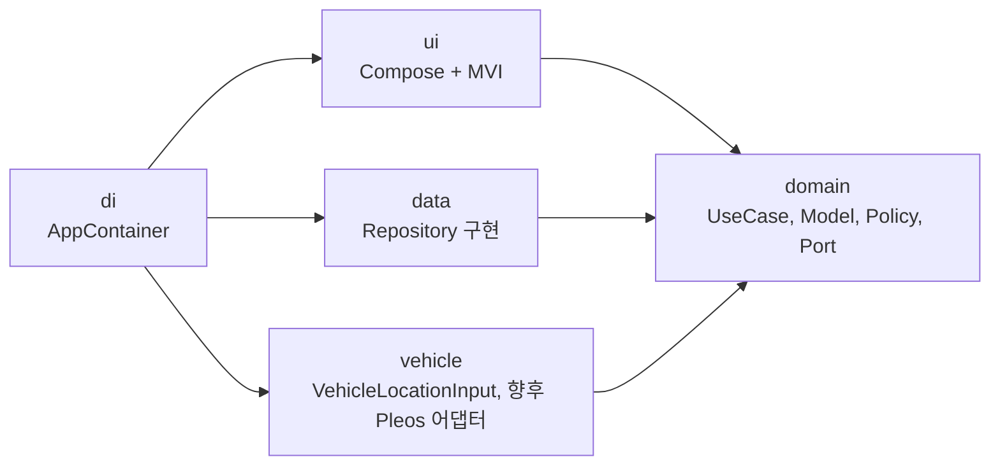
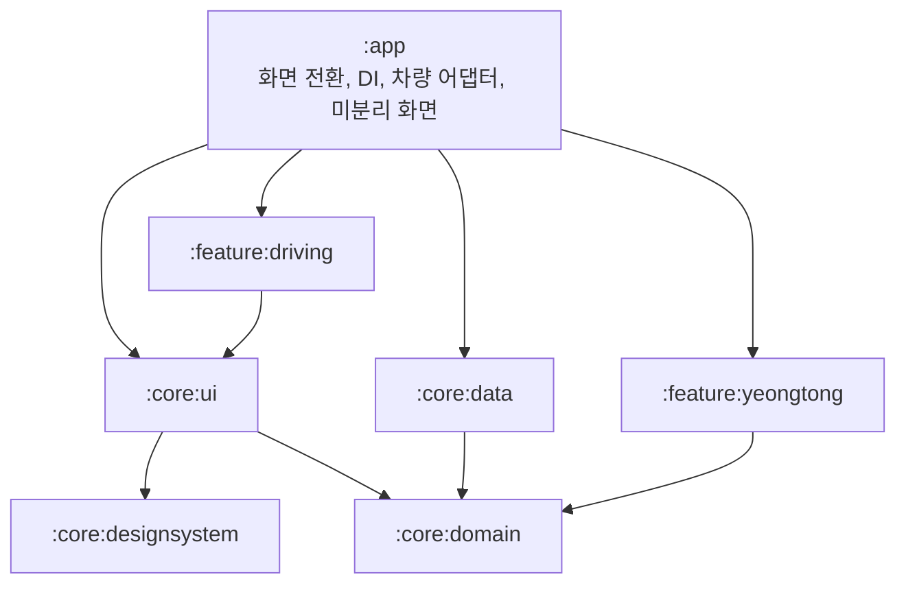
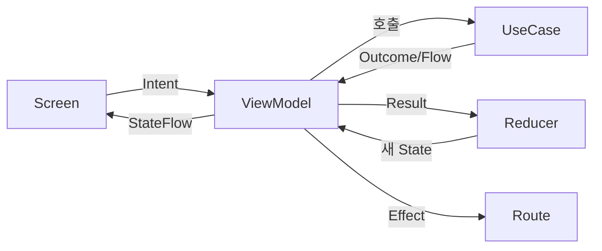
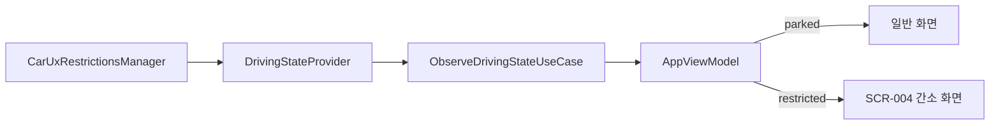
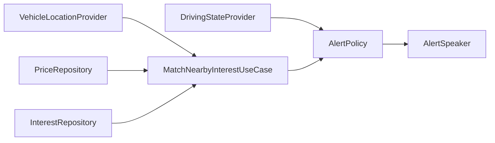

# 앱 아키텍처

Clean Architecture의 계층 분리와 MVI의 단방향 상태 관리를 사용합니다. 결정 배경은 [ADR-003](decisions/ADR-003-clean-architecture-mvi.md), [ADR-002](decisions/ADR-002-pleos-sdk-boundary.md), [ADR-008](decisions/ADR-008-gradle-module-boundaries.md), [ADR-009](decisions/ADR-009-ui-module-boundaries.md)에 있습니다.

## 개발 환경 기준

새 코드는 아래 현재 프로젝트 환경을 그대로 사용합니다. 값의 원본은 출처 파일이며, 바뀌면 이 표도 같은 PR에서 갱신합니다.

| 항목 | 값 | 출처 |
|---|---|---|
| namespace, applicationId | `com.potatoes.book5.realestate` | `app/build.gradle.kts` |
| compileSdk / targetSdk | 35 / 35 | `app/build.gradle.kts` |
| minSdk | 28 (Pleos 요구사항) | `app/build.gradle.kts` |
| JDK / jvmTarget | 17 / 17 | `app/build.gradle.kts` |
| AGP / Gradle | 8.8.2 / 8.10.2 | `gradle/libs.versions.toml`, `gradle-wrapper.properties` |
| Kotlin | 2.0.0 | `gradle/libs.versions.toml` |
| Compose BOM | 2024.04.01 | `gradle/libs.versions.toml` |
| Lifecycle | 2.9.0 | `gradle/libs.versions.toml` |
| Compose UI (실제 적용) | 1.7.8 (lifecycle-runtime-compose 2.9.0이 BOM의 1.6.6을 올림) | `./gradlew :app:dependencies` |
| Coroutines | 1.7.3 | `gradle/libs.versions.toml` |
| Activity Compose | 1.10.1 | `gradle/libs.versions.toml` |
| Core KTX | 1.16.0 | `gradle/libs.versions.toml` |
| Pleos Vehicle SDK | 2.3.2 (카탈로그에만 선언, 아직 비활성) | `gradle/libs.versions.toml` |
| Pleos Maven 저장소 | `nexus-playground.pleos.ai` | `settings.gradle.kts` |
| 실행 환경 | Pleos Connect Emulator v2.1.0. 기기 실측 API 35, 앱 창 229dpi (2026-11-14) | `adb shell getprop ro.build.version.sdk` |
| 화면 방향 | 미지정 (기본 portrait, window 1개) | `AndroidManifest.xml` |

### 환경 규칙

- SDK, Kotlin, AGP, Gradle 버전을 변경하려면 ADR을 먼저 작성합니다.
- Pleos 버전 기준은 공식 Vehicle SDK Sample App입니다.
- 에뮬레이터 실측은 API 35지만 문서(SETUP.md)에는 API 34 이미지로 적혀 있습니다. 실차 API가 확인될 때까지 API 35 전용 기능은 쓰지 않습니다.
- 버전은 `libs.versions.toml`에서만 관리하고 `build.gradle.kts`에 직접 쓰지 않습니다.
- Pleos 키는 `local.properties`와 `BuildConfig`로만 전달합니다.

### 라이브러리 사용 기준

| 구분 | 라이브러리 | 처리 |
|---|---|---|
| 사용 가능 | Compose UI, Material3, `lifecycle-viewmodel`, `lifecycle-viewmodel-savedstate`, `lifecycle-runtime-ktx` | 그대로 사용 |
| 사용 중 (T-014에서 추가) | `lifecycle-viewmodel-compose`, `lifecycle-runtime-compose` | 기존 `lifecycle` 버전 재사용. Compose UI가 1.7.8로 올라감 |
| 사용 중 (T-014에서 직접 선언) | `kotlinx-coroutines-android`, 테스트용 `kotlinx-coroutines-test` | 1.7.3 고정 |
| 사용 중 (T-016, [ADR-005](decisions/ADR-005-room-local-db.md)) | Room 2.6.1(`room-runtime`, `room-ktx`, `room-compiler`, 테스트용 `room-testing`), KSP 2.0.0-1.0.24 | 스크랩 저장. 스키마는 `core/data/schemas/`에 내보내 커밋하고, 버전을 올리면 마이그레이션 기기 테스트를 추가 |
| 사용 중 (T-013, [ADR-004](decisions/ADR-004-map-sdk.md)) | 네이버 지도 SDK 3.24.1(`com.naver.maps:map-sdk`) | 주행 지도 모드. `:feature:driving`에서만 쓰고 `AndroidView`로 감싼다. 키는 `local.properties`의 `naver.map.clientId` |
| 사용 중 (T-029) | Pleos FusedLocation 1.1.3(`ai.pleos.playground:FusedLocation`) | 차량 위치. `:app`의 `vehicle/location/PleosFusedLocationBridge`에서만 호출하고 `VehicleLocationInput`(`VehicleLocationProvider` 포트)에 넣는다([location-input.md](platform/location-input.md)) |
| 사용 시 활성화 | Pleos Vehicle, TextToSpeech, SpeechToText | [sdk-usage-map.md](platform/sdk-usage-map.md) 먼저 갱신 |
| ADR 필요 | 내비게이션, DI 프레임워크, 그 밖의 로컬 DB, DataStore | 도입 전에 ADR 작성. HTTP는 [ADR-006](decisions/ADR-006-molit-retrofit.md)에서 결정 |

## 계층과 의존 방향



의존성은 항상 `domain`을 향합니다. `domain`은 어떤 계층도 알지 못합니다.

| 패키지 | 책임 | 참조 가능 | 금지 |
|---|---|---|---|
| `ui` | 화면, MVI 상태 관리 | `domain` | `data`, `vehicle`, SDK, DTO |
| `domain` | 비즈니스 규칙, UseCase, 포트 | Kotlin 표준, coroutines core | `android.*`, `androidx.*`, SDK, 다른 계층 |
| `data` | 시세 API, 캐시, 저장소 | `domain` | `ui`, `vehicle`, SDK |
| `vehicle` | 외부 Pleos 콜백을 받을 위치 입력 포트, 향후 SDK·AAOS 어댑터 | `domain`, SDK | `ui`, `data` |
| `di` | 구현체 조립 | 전체 | 비즈니스 로직 |

Gradle 모듈도 계층 경계를 따릅니다(Now in Android 구조, ADR-008·ADR-009).



- `:core:domain`은 독립적입니다. `:core:data`와 `:feature:yeongtong`은 `:core:domain`에만 의존합니다.
- `:core:designsystem`은 테마와 도메인을 모르는 공용 컴포넌트, `:core:ui`는 여러 화면이 쓰는 표시 모델·포맷·라벨입니다.
- 화면 feature 모듈(`:feature:driving`)은 `:core:ui`까지만 의존하고 다른 feature를 참조하지 않습니다. Route는 ViewModel과 앱 설정 값을 인자로 받습니다.
- `:app`은 모듈을 조립하고 화면 전환, ViewModel 생성, 키 주입을 맡습니다. 아직 분리하지 않은 화면과 차량 어댑터도 `:app`에 둡니다.

### 현재 실거래 데이터 흐름 (T-027)

`app/vehicle/location/VehicleLocationInput`은 친구가 연결할 Pleos 위치 콜백의 입력 브리지다. `updateLocation(pose, accuracyMeters, observedAt, source)`로 받은 좌표를 `VehicleLocationProvider` 포트에 전달한다. 이 앱은 GPS 센서를 직접 읽거나 위치 권한을 요청하지 않는다. 브리지는 위치 동의, 정확도 100m 이하, 관측 시각 30초 이내를 확인한다. 개발 빌드의 경로 주입은 `EMULATOR_ROUTE` 출처로 구분한다. `app`이 `LiveMarketRepository.run`을 시작하고, 데이터 계층은 현재 위치 10km 경계 상자와 교차하는 시군구를 Vworld `LT_C_ADSIGG_INFO`에서 조회한 뒤 각 시군구의 최근 1개월 국토부 거래와 Vworld 주소 좌표를 조합한다. 실제 거래 좌표로 10km를 다시 거른다. 조회기간·시군구별 월별 원본은 메모리에서 재사용하며 Vworld 좌표를 DB에 저장하지 않는다. 유효 위치 갱신마다 현재 위치·지도 중심을 반영하고, 500m 이상 이동하거나 10km 포함 경계가 바뀌면 순위를 다시 평가한다.

홈, `:feature:driving`의 지도·순위, 상세, 관심 동네, 스크랩, 주행 기록은 같은 실제 단지 ID와 거래 흐름을 사용한다. 국토부 응답에 없는 세대수 등은 `null`과 `정보 없음`으로 유지한다. 전달 위치에 진행 방향이 없으면 지도는 북쪽을 위로 표시하고 앞·뒤를 추정하지 않는다. Pleos 차량 위치 SDK 콜백은 아직 연결되지 않았으며, 수동 주행 상태 전환은 개발용이다. 조회 범위는 전달 위치 주변의 시군구로 동적으로 정한다.

## 모듈과 패키지 구조

```
King-of-real-estate/
├── app/                 # MainActivity, Application, AppContainer, 화면 전환, 미분리 화면, vehicle/
├── core/
│   ├── designsystem/    # ui/theme, ui/common의 도메인 무관 컴포넌트·아이콘
│   ├── ui/              # ui/common의 표시 모델, 포맷, 조건·스크랩 라벨과 공용 문자열
│   ├── domain/          # domain/model, policy, error, port, usecase
│   └── data/            # data/local, sample, remote, mapper, repository; Room schemas/
└── feature/
    ├── driving/         # 주행 화면 SCR-004·SCR-005·SCR-009, 네이버 지도
    └── yeongtong/       # 영통구 거래, 주소 좌표 조회 UseCase
```

`app/ui/`에는 아직 분리하지 않은 홈·스크랩·상세·마이 페이지·주행 요약·설정 화면을 둡니다. 화면을 feature 모듈로 옮길 때도 패키지명은 유지합니다. `app/vehicle/location/`에는 외부 차량 위치 콜백 입력 브리지를 둡니다. 패키지명 `com.potatoes.book5.realestate`는 유지합니다. `AppContainer`가 위치 입력과 데이터 구현을 조립합니다. 친구의 SDK 콜백 연결 방법은 [location-input.md](platform/location-input.md)를 봅니다.

## 계층별 규칙

### domain

- UseCase는 동작 하나를 담고 `operator fun invoke`를 제공합니다.
- 외부 의존은 `domain/port`의 인터페이스로 표현합니다. 예: `PriceRepository`, `VehicleLocationProvider`, `DrivingStateProvider`, `AlertSpeaker`
- 순위, 조건 일치, 알림 허용 판단은 `policy`의 순수 함수로 작성합니다.
- 예상 가능한 실패는 예외가 아니라 `Outcome`으로 반환합니다.

```kotlin
sealed interface DomainError {
    data object Offline : DomainError
    data object Timeout : DomainError
    data class Unsupported(val capability: String) : DomainError
    data class Unknown(val cause: Throwable) : DomainError
}

sealed interface Outcome<out T> {
    data class Success<T>(val value: T) : Outcome<T>
    data class Failure(val error: DomainError) : Outcome<Nothing>
}
```

### data

- DTO와 DB 엔티티는 `data` 밖으로 노출하지 않고 `mapper`에서 도메인 모델로 변환합니다.
- 최근 조회 결과를 캐시하고 재시도와 타임아웃을 적용합니다(HW-005, HW-006).
- 개인정보를 로그에 남길 때는 마스킹합니다(SP-005).

### vehicle

- SDK 타입은 이 패키지 밖으로 노출하지 않습니다.
- 호출 전에 지원 여부를 확인하고, 미지원이면 `DomainError.Unsupported`를 반환합니다(CP-001, CP-004).
- 차량 모델명으로 분기하지 않습니다(CP-006).
- 주행 규제 상태는 `CarUxRestrictionsManager`에서 받아 `DrivingState`로 변환합니다(DI-001).
- 오디오 포커스 획득과 상실 처리는 `AlertSpeaker` 구현 안에 둡니다(AF-001).

## MVI



| 요소 | 역할 | 규칙 |
|---|---|---|
| State | 화면에 필요한 전체 상태 | 불변 `data class`, 화면당 하나 |
| Intent | 사용자 동작과 화면 이벤트 | `sealed interface`, 동작 이름으로 작성 |
| Result | UseCase 결과를 상태 변경으로 표현 | `sealed interface`, ViewModel 내부 사용 |
| Reducer | `(State, Result) -> State` | 순수 함수, 부수 효과 금지 |
| Effect | 일회성 이벤트 | 화면 이동 등 상태로 표현할 수 없는 것만 |
| ViewModel | Intent 처리, UseCase 호출 | 상태 변경은 Reducer로만 수행 |
| Route | ViewModel과 Effect 연결 | 비즈니스 로직 금지 |
| Screen | State를 그리고 Intent 전달 | ViewModel을 받지 않음, Preview 가능 |

### 화면 구현 형식

```kotlin
// RankingContract.kt
data class RankingState(
    val isLoading: Boolean = false,
    val items: List<RankedApartmentUi> = emptyList(),
    val isOffline: Boolean = false,
)

sealed interface RankingIntent {
    data object Refresh : RankingIntent
    data class SelectApartment(val id: String) : RankingIntent
}

sealed interface RankingResult {
    data object Loading : RankingResult
    data class Loaded(val items: List<RankedApartmentUi>) : RankingResult
    data class Failed(val error: DomainError) : RankingResult
}

sealed interface RankingEffect {
    data class OpenDetail(val id: String) : RankingEffect
}

// RankingReducer.kt
internal fun reduceRanking(state: RankingState, result: RankingResult): RankingState =
    when (result) {
        RankingResult.Loading -> state.copy(isLoading = true)
        is RankingResult.Loaded -> state.copy(isLoading = false, items = result.items, isOffline = false)
        is RankingResult.Failed -> state.copy(isLoading = false, isOffline = result.error == DomainError.Offline)
    }

// RankingViewModel.kt
class RankingViewModel(
    private val getNearbyRanking: GetNearbyRankingUseCase,
) : ViewModel() {
    private val _state = MutableStateFlow(RankingState())
    val state: StateFlow<RankingState> = _state.asStateFlow()

    private val _effect = Channel<RankingEffect>(Channel.BUFFERED)
    val effect: Flow<RankingEffect> = _effect.receiveAsFlow()

    fun onIntent(intent: RankingIntent) {
        when (intent) {
            RankingIntent.Refresh -> refresh()
            is RankingIntent.SelectApartment ->
                viewModelScope.launch { _effect.send(RankingEffect.OpenDetail(intent.id)) }
        }
    }

    private fun refresh() {
        viewModelScope.launch {
            apply(RankingResult.Loading)
            when (val outcome = getNearbyRanking()) {
                is Outcome.Success -> apply(RankingResult.Loaded(outcome.value.map { it.toUi() }))
                is Outcome.Failure -> apply(RankingResult.Failed(outcome.error))
            }
        }
    }

    private fun apply(result: RankingResult) {
        _state.update { reduceRanking(it, result) }
    }
}
```

### MVI 규칙

- `MutableStateFlow`는 ViewModel 밖으로 노출하지 않습니다.
- Composable에서 UseCase나 저장소를 호출하지 않습니다.
- 화면 표시용 값은 `ui` 모델로 변환하고, 문자열과 형식은 `ui`에서 처리합니다.
- State는 `collectAsStateWithLifecycle`로 구독해 백그라운드에서 수집을 멈춥니다(SM-006).
- Effect는 Route에서 수명주기에 맞춰 수집합니다.
- 프로세스 재생성 후에도 필요한 입력값은 `SavedStateHandle`로 복원합니다(SM-009).

## 차량 상태 처리

### 주행 규제



- 앱 전체 주행 상태는 `AppViewModel` 하나에서 관리합니다.
- 개별 화면이 규제 API를 직접 구독하지 않습니다.
- 기능별 허용 범위는 [feature-state-matrix.md](product/feature-state-matrix.md)를 따릅니다.

### 관심 매물 알림



- 조건 일치와 알림 허용 판단은 `domain`에 두어 JVM 테스트로 검증합니다.
- 실행 위치(포그라운드 또는 백그라운드)와 주행 중 허용 여부는 T-001 답변 후 확정합니다.
- 폴링을 최소화하고 위치 갱신 조건을 정의합니다(SM-007, SM-008).
- 주행 중 CPU 5% 미만 기준을 지킵니다(PF-002).

## 의존성 주입

DI 프레임워크 없이 `AppContainer`로 구현체를 수동 조립합니다. `RealEstateApplication`이 컨테이너를 보유하고 ViewModel Factory(`AppViewModels`)에서 사용합니다. feature 모듈의 ViewModel도 이 Factory가 만들어 Route에 넘깁니다(ADR-009). 프레임워크가 필요해지면 ADR을 작성합니다.

## 테스트

| 대상 | 방법 | 레벨 |
|---|---|---|
| `domain` policy, UseCase | JVM 단위 테스트, 포트는 Fake 구현 | L1 |
| Reducer | JVM 단위 테스트 (입력 상태와 Result로 검증) | L1 |
| ViewModel | Fake UseCase, `kotlinx-coroutines-test` | L1 |
| `data` mapper, repository | JVM 단위 테스트 | L1 |
| Screen | Compose UI 테스트 | L2 |
| `vehicle` 어댑터 | Pleos 에뮬레이터, Virtual Console | L2, L3 |

검증 명령은 [QUALITY.md](QUALITY.md)를 봅니다.

## 코드 리뷰 체크리스트

- [ ] 의존 방향을 지켰는가 (`domain`에 Android import 없음, `ui`에 `data`·`vehicle` import 없음)
- [ ] SDK 타입이 `vehicle` 밖으로 나가지 않는가
- [ ] 상태 변경이 Reducer로만 이루어지는가
- [ ] Screen이 ViewModel 없이 Preview 가능한가
- [ ] 지원 여부 확인과 미지원 동작이 있는가
- [ ] 새 라이브러리가 [라이브러리 사용 기준](#라이브러리-사용-기준)을 따르는가

## 저장소 구조

```
King-of-real-estate/
├── AGENTS.md, CLAUDE.md, CONTRIBUTING.md
├── .claude/          # 공용 스킬, 에이전트, 권한
├── .github/          # PR·이슈 템플릿, CODEOWNERS
├── harness/          # 검증, ID 발급, git 훅
├── app/              # Android 앱, 화면 전환·DI·차량 어댑터·미분리 화면
├── core/
│   ├── designsystem/ # 테마·공용 컴포넌트
│   ├── ui/           # 공용 표시 모델·포맷·문구
│   ├── domain/       # 모델·포트·UseCase·순수 정책
│   └── data/         # Retrofit·Room·저장소 구현
├── feature/
│   ├── driving/      # 주행 화면과 지도
│   └── yeongtong/    # 영통구 거래·좌표 기능
├── gradle/libs.versions.toml
└── docs/
    ├── tracking/     # 작업과 ID 색인
    ├── team/         # 협업 규칙
    ├── product/      # 기능, 시나리오
    ├── principles/   # Pleos 설계 원칙
    ├── platform/     # SDK·API 정책
    ├── design/       # Figma 입력 문서
    ├── decisions/    # ADR
    ├── plans/        # 실행 계획
    ├── references/   # 외부 자료
    └── learnings/    # 실패와 개선 기록
```


### T-031 지역 순위

MarketRoundTracker(domain)는 공식 지역 코드가 연속 확인된 관측 시각으로 30초 전환을 판정한다. LiveMarketRepository(data)는 현재 구 안 3km의 실제 거래만 선정한다. 지도 축척은 feature/driving에서 독립적으로 근거리 배율(최소 줌 18.5)로 유지한다. 주행 기록은 Room v4의 지역 방문·최고가 기록을 사용하며 기존 기록을 보존한다. SDK 환경과 차량 위치 입력 포트는 변경하지 않는다.
