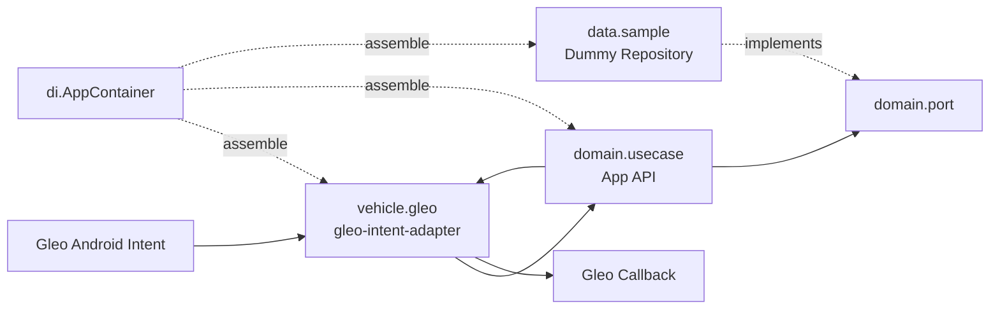

# ADR-006 Gleo Intent 어댑터와 App API 경계

## 배경

Gleo가 생성한 Android Intent를 앱 기능에 연결해야 한다. 기존 ADR-003은 단일 app 모듈, domain 방향 의존성, 화면 MVI를 채택했다. Gleo 요청을 ViewModel에 전달하면 화면 생명주기와 외부 호출이 결합되고, 어댑터가 저장소를 직접 호출하면 vehicle→data 금지 규칙을 위반한다.

초기 계획 이후 사용자가 최신 main 기준 이관과 dummy 구현을 요청했다. 이 결정은 기존 아키텍처 안의 구현 경계를 명시하며 운영 Gleo 등록·승인을 의미하지 않는다.

## 선택지

1. Receiver에서 ViewModel/MVI Intent로 변환한다.
2. vehicle.gleo의 gleo-intent-adapter가 domain UseCase를 호출한다.
3. 별도 gleo-intent-adapter Gradle 모듈과 application 계층을 추가한다.

## 제안 결정

2번을 제안한다. 논리 컴포넌트 이름은 `gleo-intent-adapter`, Kotlin 패키지는 `com.potatoes.book5.realestate.vehicle.gleo`, 중심 클래스는 `GleoIntentAdapter`로 한다. 별도 모듈/최상위 계층은 추가하지 않는다.

- 어댑터: Android Intent 수신·wire 파싱·전달 형식 검증·액션 dispatch·Callback 인코딩/송신·호출 생명주기만 담당한다.
- domain: Android/JSON/Gleo wire 타입 없이 3개 UseCase와 모델/포트로 App API 계약을 제공한다. UseCase마다 `operator fun invoke`와 기존 `Outcome`을 사용한다.
- data: 포트를 구현하는 Dummy Repository가 합성 결과를 제공한다. 실제 저장·조회·프로필 변경을 수행하지 않는다.
- di: 기존 AppContainer에서 Repository→UseCase→Adapter를 조립한다. vehicle이 data/di 구현을 import하지 않는다. 루트 debug Receiver가 Android 진입점 bootstrap으로 Application의 이미 조립된 Adapter를 얻어 위임한다.
- ui: 이번 범위에서 변경하지 않는다. 이후 화면이 필요하면 같은 UseCase/도메인 데이터를 기존 MVI로 사용한다. Receiver가 ViewModel을 생성하거나 Reducer를 호출하지 않는다.

실행 시에는 UseCase가 port를 통해 Dummy Repository를 호출한다. 위 그림의 코드 의존성은 항상 domain을 향한다.

## 결과와 영향

- [App API 계약](../api/app-action-api.md)과 [외부 어댑터 계약](../api/gleo-intent-adapter.md)을 별도로 관리한다.
- Android Intent, MVI Intent, domain API 입력은 서로 다른 타입으로 취급한다.
- 초기 구현은 debug 전용의 비영속 dummy로 하고 release에서 외부 호출할 수 없도록 한다.
- 카테고리·DO·개인정보 처리 방식과 운영 Gleo 호출자 인증은 이 ADR로 승인하지 않는다.
- 상세 순서와 검증은 [T-021 계획](../plans/active/T-021-gleo-intent-adapter-dummy.md)을 따른다.

## 미결 사항

- 구현 전 최신 main 동기화와 등록 ID 충돌을 해소한다.
- 실제 Gleo의 Intent extra 키, Callback 목적지·호출자 인증·상관관계 정보를 확인한다.
- 운영 환경의 현재 위치/직전 지역 해석, 실제 영속화, 음성 출력은 후속 기능으로 검증한다.
