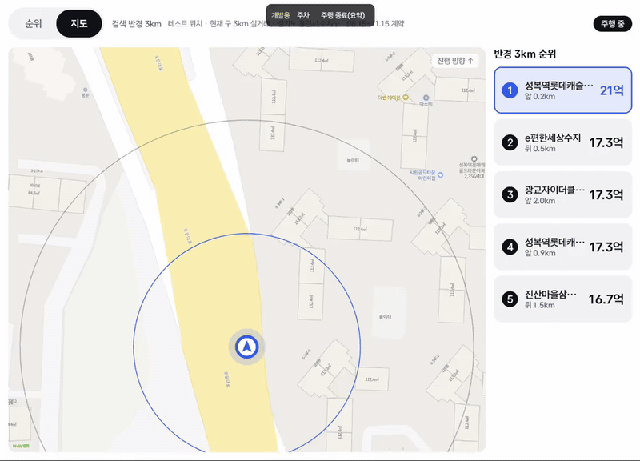

# 주행 PoC 시연

## 지도 Top 5 · 순위 Top 3 · 단지 접근 마커

[MP4 영상](T037-driving-demo.mp4)

- 2026-11-15 실제 Pleos 에뮬레이터 녹화에서 앱 영역을 잘라 핵심 장면을 추렸다. 영상 배속은 변경하지 않았다.
- 최근 달력 3개월 실거래: 녹화 시각 기준 08.15~11.15. 지도는 최대 5개, 순위 탭·주행 기록은 최대 3개다.
- 죽전역에서 성복역 롯데캐슬 골드타운 방향의 도로 경로를 테스트 위치로 재현했다. 긴 중간 구간은 생략하고 마지막 구간은 30km/h로 이동했다.
- 지도 Top 5 → 순위 탭 Top 3 → 지도 복귀·왕관 마커를 확인할 수 있다. 마커는 실제 조회 좌표에 있으며, 가까이 접근해 화면 안에 들어오면 보인다.
- 경로 출처: [OSRM](https://project-osrm.org/) / [OpenStreetMap contributors](https://www.openstreetmap.org/copyright), ODbL. 목적지 도로명주소는 국토부 K-APT 기본정보 응답으로 확인했다.
- 테스트 좌표 입력의 시연이며 실제 Pleos GPS·속도계·교통 신호·TTS를 검증한 영상은 아니다. 키나 원좌표는 녹화물에 포함하지 않았다.

관련 작업: T-036, T-037, T-038.
