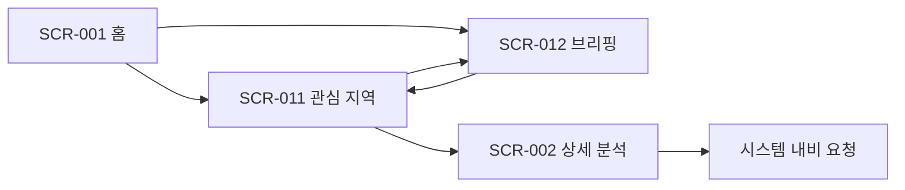

# 화면 흐름

## 규칙

- 주행 중에는 SCR-004, SCR-009, SCR-005만 표시합니다. 다른 화면에 있었다면 상태를 저장하고 전환합니다(S-005).
- 다단계 이동은 홈에서 최대 2단계로 제한합니다(DD-009, 제안값).

## S-011 주차 탐색 확장

- 위 경로는 주차 준비 완료에서의 정보 구조 초안이다. 신규 와이어프레임/Figma는 아직 없다.
- 주행/신호 대기에서 상세·지역 목록·브리핑 상세 진입을 차단한다. 조건부 간소 카드만 기존 SCR-004/SCR-005에서 다룬다.
- 상세→내비 요청 결과와 시스템 Navigation 화면 표시는 F-012에 따른다. 일반 앱이 카메라 화면을 강제로 열지 않는다.
- 카테고리/DO/주행 허용은 [상태 매트릭스](../../product/feature-state-matrix.md)가 우선한다.
