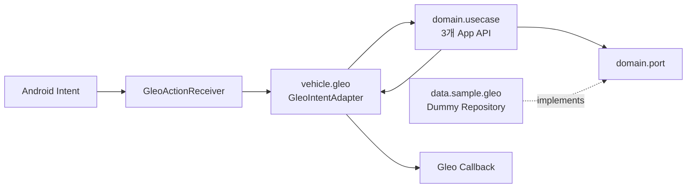

# T-021 gleo-intent-adapter와 dummy App API 구현 계획

## 목표

기존 Clean Architecture + MVI를 유지하면서 `Android Intent → gleo-intent-adapter → domain UseCase → Dummy Repository → Gleo Callback` 경로를 구현할 수 있게 API와 단계별 검증 계획을 정리한다.

사용자는 최신 origin/main 기반 이관 후 dummy 구현까지 진행하도록 범위를 확정했다. 기존 계획의 API/의존성 경계를 유지하며 아래 체크리스트를 구현/검증 결과에 맞춰 갱신한다.

## 기준과 저장소 상태

- 현재 작업 브랜치: geonu/gleo-intent-adapter. 최신 origin/main c116c7d에서 새로 시작했다. 이전 계획은 backup/gleo-spec-plan-20261114에 보존했다.
- 구현 기준 origin/main: c116c7d. git fetch --prune 및 git ls-remote로 GitHub main과 동일함을 확인했다. 온보딩·홈·주행·스크랩·마이 페이지·주행 요약·설정과 Room 구현을 유지한다.
- 두 기준 모두 ADR-003의 단일 app 모듈, domain 방향 의존성, 화면 MVI, 수동 AppContainer를 유지한다.
- 최신 main의 AppContainer에는 consent/interest/Room scrap/sample ranking·detail/usecase/simulation 연결이 이미 있다. 빈 AppContainer나 Outcome을 새로 덮어쓰지 않는다.
- 최신 main은 Room 관련 ADR 번호를 사용 중이다. 이번 계획/ADR 번호는 최신 원장으로 스크립트를 실행해 충돌을 피했다.
- 기존 Gleo 브랜치의 작업 번호 중 최신 main의 온보딩 작업과 충돌하는 항목이 있다. 기존 원격 브랜치 이력을 재작성하지 않고, 이번 이관에서 스펙 작업은 T-020, 구현 작업은 T-021로 재등록하고 문서를 병합했다.
- 상세 근거: [ARCHITECTURE](../../ARCHITECTURE.md), [ADR-003](../../decisions/ADR-003-clean-architecture-mvi.md), [ADR-006 제안](../../decisions/ADR-006-gleo-intent-adapter.md).

## 범위 밖

- 실제 시세·청약·뉴스 공급자, GPS/지오펜스, 영속 지역 저장
- UI 화면 추가/수정, ViewModel/Reducer 직접 호출, 자연어 해석기 자체 구현
- 자동 발화·카메라·내비·주행 실행 승인
- 새 Gradle 모듈, HTTP 서버/DI/직렬화/DB 프레임워크 도입, SDK 버전 변경

## 권장 구조

논리 컴포넌트 이름은 `gleo-intent-adapter`다. Kotlin 패키지에는 하이픈을 쓰지 않고 `vehicle.gleo`로 배치한다. Gleo가 자연어를 해석해 보낸 Android Intent를 이 컴포넌트가 수신한다. 앱이 같은 자연어를 다시 해석하지 않는다.



| 계층 | 추가/재사용 책임 | 금지 |
|---|---|---|
| vehicle.gleo | Intent 처리·파싱·형식 검증·dispatch·인코딩·송신·기한 | di/data/UI import, 가격/저장 로직 |
| 루트 debug Receiver | Android 수신·DI 연결·goAsync/finish | 입력 해석·비즈니스 규칙·저장소 직접 호출 |
| domain.model/port/usecase | 타입·규칙·포트·3개 API | Android/JSON/Gleo status/SDK import |
| data.sample.gleo | 결정적 합성 Repository | vehicle/UI 호출, 실제 DB/설정 변경 |
| di.AppContainer | 기존 컨테이너에 새 구현 연결 | 비즈니스 규칙·새 컨테이너로 교체 |
| ui | 이번 범위 변경 없음 | Receiver에서 ViewModel 생성/직접 상태 변경 |

Android Intent와 화면의 MVI Intent는 별개다. 외부 요청은 화면을 거치지 않고 UseCase를 호출한다. 후속 UI가 필요하면 domain 데이터 변화→ViewModel Result→Reducer→State로 반영하며 기존 규칙을 유지한다.

## 계획할 파일 배치

아래는 구현 후의 예상 경로이며 현재 파일 존재를 의미하지 않는다. 최신 main의 기존 타입/디렉토리와 대조한 뒤 파일을 추가한다.

```text
app/src/main/java/com/potatoes/book5/realestate/
├── domain/
│   ├── model/appaction/          # AreaTarget, AppCallContext, typed 결과
│   ├── port/                    # 가격 요약·관심 지역·브리핑 포트
│   └── usecase/
│       ├── GetAreaPriceSummaryUseCase.kt
│       ├── SaveInterestAreaUseCase.kt
│       └── GetDailyBriefingUseCase.kt
├── data/sample/gleo/             # 포트의 Dummy 구현
├── vehicle/gleo/
│   ├── GleoIntentAdapter.kt
│   ├── GleoIntentDecoder.kt      # Android/JSON 진입 경계
│   ├── GleoRequestValidator.kt   # 정규화 DTO의 순수 검증
│   ├── GleoCallbackEncoder.kt
│   ├── GleoCallbackSender.kt     # 전송 인터페이스 + Android 구현
│   └── GleoRequestCoordinator.kt # single-flight·기한·1회 완료
└── di/AppContainer.kt           # 기존 조립에 추가

app/src/debug/
├── AndroidManifest.xml          # 개발용 수신점만 등록
└── java/.../realestate/GleoActionReceiver.kt  # 루트 Android 진입점, DI 연결만
```

Receiver는 기존 MainActivity와 같은 루트 Android 진입점 패키지에 둔다. 루트 Receiver만 Application의 AppContainer를 얻어 이미 조립된 Adapter에 위임한다. vehicle.gleo 안에서 AppContainer/RealEstateApplication을 역참조하지 않는다. Receiver를 debug 소스에만 두고 main/release에 참조하지 않는다. 실제 Gleo 등록용 debug asset 추가 여부는 설치 버전과 승인 절차 검증 후 결정한다. 이번 초안이 runtime schema를 자동 등록하는 것은 아니다.

## 문서 소유권

| 문서 | 소유할 내용 |
|---|---|
| [App API](../../api/app-action-api.md) | 순수 Kotlin 입력·typed 결과·오류·dummy 부작용 |
| [어댑터 계약](../../api/gleo-intent-adapter.md) | Intent/Callback wire·target 변환·수신 생명주기 |
| F-010/F-011/F-013 | 사용자 기능·영속 저장·브리핑의 실제 제품 요구 |
| 플랫폼 문서 | 공식 규격·설치 환경의 확인/미확인 구분 |
| 이 계획 | 파일 배치·순서·검증·완료 기준 |

## API와 dummy 기본안

- 외부 함수 3개를 유지한다. 가격 조회와 저장은 target enum으로 현재/직전/지정 지역을 구분한다. 실제 schema 변경은 구현 단계에 API/테스트와 함께 수행한다.
- 3개 domain UseCase는 각자 하나의 동작과 `operator fun invoke`를 제공한다. 별도의 call Service 계층을 만들지 않는다.
- 가격/브리핑은 합성 fixture를 반환한다. 위치/실제 지역 해석은 하지 않는다.
- 저장 dummy는 실제 저장소에 접근하지 않고 NOT_APPLIED/persisted=false 결과를 반환한다. 어댑터는 이를 저장 success로 안내하지 않는다.
- 모든 초기 Callback은 silent이고 합성 메타데이터를 포함한다. Gleo 자연어 음성의 실제 정확도와 데이터 기능 구현은 별도 단계다.
- 세션·요청 ID를 Gleo가 준다고 가정하지 않는다. 앱 내부 ID와 합성 문맥만 사용한다.
- 동시성/timeout/오류 매핑은 어댑터 계약의 단일 기준을 따른다.

## 구현 순서와 독립 완료 기준

### 0. 기준 브랜치와 ID 정리

- [ ] 최신 main을 다시 확인하고 Gleo 문서와 통합할 기준 브랜치를 준비한다. 사용자 변경을 덮어쓰지 않는다.
- [ ] 기존 작업 번호 충돌을 새 ID로 조정하고 관련 frontmatter/Refs/색인을 함께 수정한다. 과거 승인된 Room ADR을 대체하지 않는다.
- [ ] 기존 main의 AppContainer/Outcome/포트/샘플 모델과 실제 라이브러리 버전을 재확인한다.
- [ ] 문서·ID 검사 통과. 새로운 구현 작업 ID를 등록하고 이 계획에 연결한다.

### 1. 계약을 고정하고 스키마·테스트와 맞춤

- [ ] App API의 입력/결과/오류·dummy 의미를 검토한다.
- [ ] 스키마에 target enum을 추가하고 areaQuery와의 조합 검증을 정의한다. 명시적 합성 대상 호출만 검증하며, 맥락 없는 ‘이 동네’의 운영 해석은 기존 F-010과 별도 대조 전 지원 완료로 표시하지 않는다.
- [ ] wire profile을 테스트 입력 기준으로 명시한다. 실제 설치된 Gleo 확인 전에는 호환성을 확정하지 않는다.
- [ ] 기존 테스트 중 현재/직전 지역 선택·timeout·저장 성공 조건을 새 계약과 연결한다. 실제 영속화 케이스를 dummy 통과로 처리하지 않는다.

### 2. domain API와 포트를 구현

- [ ] 기존 Outcome/DomainError와 재사용 가능한 타입을 활용한다.
- [ ] 순수 Kotlin target/context/결과와 3개 UseCase를 구현한다.
- [ ] 예상 가능한 입력/지원 실패를 Outcome으로 반환하고 cancellation을 삼키지 않는다.
- [ ] Android 없는 JVM 테스트로 검증한다.

### 3. Dummy Repository를 구현

- [ ] data.sample.gleo에 포트 구현을 둔다. 합성 fixture는 주입/고정 시계로 결정적 결과를 보장한다.
- [ ] 가격/브리핑은 원천·기간·synthetic 표식을 갖는다.
- [ ] 저장은 NOT_APPLIED/persisted=false이며 Room/SharedPreferences/파일/네트워크를 건드리지 않는다.
- [ ] 같은 입력·fixture의 같은 출력과 부작용 없음을 테스트한다.

### 4. gleo-intent-adapter를 구현

- [ ] 선택한 profile의 Android Intent→wire DTO decode와 순수 검증을 분리한다.
- [ ] 알려진 3개 action을 적절한 domain UseCase에 연결한다.
- [ ] 결과/오류→공식 Callback envelope를 변환하고 data를 JSON 배열 문자열로 인코딩한다.
- [ ] 합성 저장은 fail, 합성 조회는 명시적 synthetic success로 반환한다. 모두 silent다.
- [ ] single-flight/전체 deadline/최대 1회 응답/마감 후 응답 금지 경합을 테스트한다.

### 5. debug Receiver와 DI를 연결

- [ ] 기존 AppContainer가 Dummy Repository→UseCase→Adapter를 조립한다.
- [ ] 루트 debug Receiver만 Application의 기존 컨테이너에 접근한다. vehicle.gleo는 DI가 생성자 주입한 UseCase/sender/coordinator만 사용하며 di/root Application import가 없다. ViewModel/Activity를 생성하지 않는다.
- [ ] debug Receiver의 goAsync/finally finish를 구현하고 main thread를 막지 않는다.
- [ ] Callback test sink는 DI에서 고정한다. 요청 extras의 목적지·프로필·권한 값을 신뢰하지 않는다.
- [ ] release merged manifest에서 수신점이 노출되지 않는지 확인한다.

### 6. 검증·리뷰·문서 갱신

- [ ] Docs, L1 통과. 실행 가능한 장치가 있으면 L2와 명시 Intent 주입을 수행한다.
- [ ] 별도 reviewer로 의존성 방향·수신 생명주기·dummy 비영속성·Callback 변환을 검토한다.
- [ ] 아키텍처/SDK 맵/기능/API/테스트 상태를 실제 구현 범위로 갱신한다.
- [ ] 실제 Gleo 검증 없이 자연어 E2E 통과/스키마 승인/주행 허용을 기록하지 않는다.

## 검증 방법

| 범위 | 핵심 케이스 | 환경 |
|---|---|---|
| domain API | target 조합, 합성 결과, 문맥 없음, 미지원 실제 지역, 오류 | JVM/L1 |
| adapter 순수 부분 | 3개 dispatch, 잘못된 타입/enum, 요청→결과 매핑 | JVM/L1 |
| coordinator | timeout/성공 경합, 중복 수신, 늦은 결과, 예외/취소 | coroutine 가상 시간/L1 |
| Android wire | ACTION_PARAM 객체 파싱, malformed JSON, action/extra, data 직렬화 | instrumentation/L2 |
| Receiver/DI | 실제 broadcast 수신, finish 경로, 기존 컨테이너·화면 비의존 | debug APK/L2 |
| dummy 저장 | persisted=false, DB/설정/스크랩/읽음 변화 없음 | JVM + 필요한 통합 검사 |
| release | merged manifest·assets에 외부 dummy 수신/자동 등록 없음 | 빌드 산출물 검사 |
| 실제 Gleo | 스키마 선택/실제 wire/Callback/음성 | 후속 Gate. 초기 완료 범위 밖 |

JVM 테스트에서 Android JSONObject 구현을 사용하려고 Robolectric 같은 새 프레임워크를 넣지 않는다. 순수 검증과 Android codec을 분리하고 codec은 실제 Android instrumentation으로 확인한다. coroutines는 최신 main의 기존 1.7.3 직접 의존성을 재사용한다. 오래된 브랜치에서 시작한다면 먼저 main 동기화로 해결하며 버전을 임의 추가/변경하지 않는다.

실행 명령: `./harness/verify.sh --docs`, 구현 후 `./harness/verify.sh`, 장치가 준비되면 `./harness/verify.sh --device`.

## 최종 완료 정의 — 향후 dummy 구현

1. debug의 알려진 Intent가 올바른 UseCase를 거쳐 결정적인 dummy 결과/Callback을 만든다.
2. vehicle→domain, data→domain, di→구현 조립 의존성을 지킨다. UI/MVI를 우회한 직접 상태 변경이 없다.
3. 실제 저장/네트워크/GPS/음성/차량 제어를 수행하지 않는다. 합성을 실제 지역 가격/저장 완료로 표현하지 않는다.
4. 잘못된 입력·동시 수신·timeout/취소에서도 중복 응답과 리소스 누수가 없다.
5. release 노출과 실제 Gleo 호환성을 별도로 검증하고 범위를 정확히 기록한다.

## 결정 로그

- 초기 계획 전용 범위를 사용자의 후속 답변으로 dummy 구현까지 확장했다. 앱의 기존 UI/Room/SDK 버전은 유지한다.
- 논리 컴포넌트를 vehicle.gleo에 두어 기존 계층을 확장하고, 새 module/application layer는 만들지 않는다.
- 내부 API는 3개 UseCase의 호출 계약으로 분리하고 HTTP를 도입하지 않는다.
- dummy는 data.sample 구현체로 격리한다. 실제 API로 바꿀 때 wire/UseCase 전체를 다시 작성하지 않도록 포트를 유지한다.
- 최신 main은 현재 브랜치보다 진전되어 있다. 기준 동기화·ID 충돌 해소가 구현의 첫 단계다.
- 카테고리·DO·개인정보 처리/실제 인증 정책은 이번 문서로 승인하지 않는다.

## 진행 기록

- 2026-11-14: 기존 아키텍처와 최신 main 코드/원장을 대조했다. 최신 main 기준으로 T-021/ADR-006 번호를 산출하고 계획·API·ADR 초안을 작성했다.
- 앱 구현·빌드·앱 테스트는 수행하지 않았다. 아래에는 계획 문서 자체의 검사 결과만 기록한다.

- 2026-11-14: 계획/API/ADR의 상대 링크·원장·공백 검사를 통과했다. 별도 reviewer가 아키텍처·dummy 의미·수신 생명주기를 검토했고 중대한 지적 없음으로 확인했다. 자가 검토에서 manifest Receiver의 DI 연결을 루트 bootstrap으로 명시해 vehicle→di 역참조를 방지했고, reviewer 재확인도 완료했다. 구현 체크리스트는 모두 미착수이며 앱 테스트는 실행하지 않았다.

- 2026-11-14: 원격 main=c116c7d 확인, 새 브랜치 생성, 5550ee7/48895f2를 cherry-pick하여 스펙·계획 이관. 기존 main의 T-014~T-019/ADR-005를 보존하고 스펙 T-020/구현 T-021로 조정했다.
