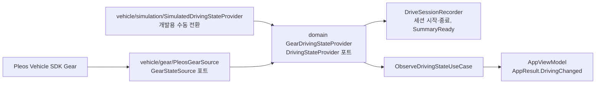

# T-034 Pleos 기어 상태로 주행 중과 주행 완료 판정

## 목표

개발용 수동 전환(`SimulatedDrivingStateProvider`)만으로 정하던 주행 상태(`DrivingState`)를 Pleos Vehicle SDK의 기어 상태로 정한다. 기어 P는 주행 완료(주차), 그 밖의 기어는 주행 중이다. 이 상태가 화면 전환(S-005, `AppViewModel.showDriving`)과 주행 세션 기록·요약(F-009, S-009, SCR-008)을 그대로 움직인다.

## 범위 밖

- `CarUxRestrictions` 연동(DI-001, DI-002). 주행 중 기능 제한 플래그는 별도 작업이다. 이 작업의 `DrivingState`는 주행 세션과 화면 전환 기준이다.
- AAOS `CarPropertyManager`의 `GEAR_SELECTION`(API-002, CP-005). 사용자가 Pleos 기어 API를 쓰기로 정했다(결정 로그).
- 미지원 안내 UI. 기어를 읽지 못하면 앱은 주차 상태로 남고, 개발 빌드에서는 수동 전환을 쓴다.
- 기어 외 신호(속도, 주차 브레이크)로 주행을 보정하는 것

## 조사 결과

[sdk-usage-map.md](../../platform/sdk-usage-map.md#기어-상태-t-032)에 정리했다. 요점:

- 공식 문서(Vehicle SDK v2.3.1 기준)의 `Vehicle` 함수 목록과 권한 표에는 기어가 없다. 저장소의 Vehicle SDK 2.3.2(`libs.versions.toml`에 이미 선언된 버전) AAR에는 `Vehicle.getGear(): Gear`가 있다.
- `Gear.getCurrentGearSelectionState(onComplete: (VehicleGear?) -> Unit, onFailed: (Exception) -> Unit)`, `registerGearSelection(GearSelectionListener)`, `unregisterGearSelection(...)`. 리스너는 `onSelected(VehicleGear?)`, `onFailed(Exception)`.
- `VehicleGear`: `GEAR_UNKNOWN`, `GEAR_NEUTRAL`, `GEAR_REVERSE`, `GEAR_PARK`, `GEAR_DRIVE`, `GEAR_1`~`GEAR_9`
- 권한: 세 함수의 `@RequiresPermission`이 `pleos.car.permission.CAR_DRIVE`다. 공식 샘플 앱 매니페스트는 이 권한을 Vehicle Service의 normal 보호 수준 읽기 권한으로 선언한다.
- `Gear`에는 `checkXXXCapabilities`가 없다.

## 설계

- domain
  - `GearPosition`(PARK, REVERSE, NEUTRAL, DRIVE, MANUAL, UNKNOWN), `GearReading`(`Selected`, `Unavailable`)
  - 포트 `GearStateSource.gear: Flow<GearReading>`. 수집하는 동안 SDK에 연결한다.
  - `GearDrivingStateProvider(gearSource, fallback, scope)`가 기존 `DrivingStateProvider` 포트를 구현한다. 판정 규칙은 `resolveDrivingState`다.
    - P → PARKED, R·N·D·수동 단수 → DRIVING, UNKNOWN·null → 상태 유지
    - 기어를 한 번도 읽지 못했으면 대체 흐름(개발용 수동 전환)을 따른다. 출시 빌드는 수동 전환 버튼이 없어 주차로 남는다.
    - 기어를 읽은 뒤 오류가 오면 마지막 상태를 유지한다. 일시 오류로 세션이 닫히고 요약이 뜨지 않게 한다.
    - 개발용 수동 전환은 기어를 읽은 뒤에도 다음 기어 변경 전까지 우선한다(개발 빌드 버튼 유지).
    - `stateIn(WhileSubscribed)`로 공유해 주행 기록과 화면이 SDK 연결 하나를 쓴다.
- vehicle: `vehicle/gear/PleosGearSource`
  - 새 `Vehicle` → `initialize()` → `getGear().registerGearSelection` → `getCurrentGearSelectionState`. 닫을 때 `unregisterGearSelection` → `release()`
  - 지원 확인 API가 없어 호출 실패(`onFailed`, 예외)를 `Unavailable`로 보낸다. 차량 모델명으로 분기하지 않는다(CP-006).
  - 연결 직후 현재 값 조회가 실패할 수 있어, 기어를 받기 전까지 2초 간격으로 3번까지 묻는다(HW-006).
- MVI: 변경 없음. `AppViewModel`은 `ObserveDrivingStateUseCase` → `AppResult.DrivingChanged`로 받고, 주차 후 요약은 `DriveSessionRecorder` → `ObserveUnseenDriveSummaryUseCase` → `AppResult.SummaryReady` → SCR-008로 이어진다.
- 의존성과 권한: `implementation(libs.pleos.vehicle)`(2.3.2), 매니페스트 `pleos.car.permission.CAR_DRIVE`. SDK가 `VEHICLE_BINDING` 권한과 `VEHICLE_START` 쿼리를 병합한다.

## 작업 체크리스트

- [x] T-034 등록(앞 번호는 main에 아직 머지되지 않은 지역 순위 작업 브랜치가 사용 중)
- [x] Vehicle SDK 기어 API 조사와 sdk-usage-map 기록
- [x] domain 모델·포트·`GearDrivingStateProvider`와 단위 테스트
- [x] `PleosGearSource`, 의존성, 권한, AppContainer 연결
- [x] F-009, S-005, S-009, SCR-008, ARCHITECTURE, driving-restriction-impl 갱신
- [x] L1 검증(`./harness/verify.sh`, `:core:domain:test`, `--docs`)
- [x] 에뮬레이터에서 기어 미지원 대체 흐름 확인(서비스 없음 → 주차 유지, 비정상 종료 없음)
- [ ] 개발 버튼으로 수동 전환 확인. 이 AVD에서는 버튼이 상태 표시줄 아래에 있어 누를 수 없었다(기존 화면 배치 문제)
- [ ] Vehicle 서비스가 있는 환경(데브박스·실차)에서 P ↔ D 전환으로 화면 전환과 요약 확인

## 검증 방법

- L1: `./gradlew :core:domain:test`(판정 규칙), `./harness/verify.sh`, `./harness/verify.sh --docs`
- 에뮬레이터: Pleos Vehicle 서비스가 없으면 `PleosGear` 경고 로그 후 개발 버튼으로 주행 전환이 되는지 본다.
- 서비스가 있는 환경: Virtual Console(`adb forward tcp:8088 tcp:8088`)이나 실차에서 기어를 D로 바꾸면 주행 화면(SCR-004)으로, P로 바꾸고 3분 뒤 주행 요약(SCR-008)이 뜨는지 본다.

## 미결

- 공식 문서에 `Gear` 도메인, `VehicleGear` 값, `CAR_DRIVE`와 기어의 관계가 없다. SDK 2.3.2 바이너리와 공식 샘플 앱 매니페스트로 확인했다. 문서가 갱신되면 대조한다.
- 지원 여부 확인 방법. `checkGearCapabilities`가 없다. 미지원 차량에서 어떤 오류(`ERROR_NOT_SUPPORTED_PROPERTY` 등)가 오는지 확인 필요
- `registerGearSelection`이 등록 직후 현재 값을 보내는지, 콜백 스레드, 서비스 연결이 끊긴 뒤 자동 재연결 여부
- `initialize()` 직후 바로 API를 불러도 되는지(문서에 연결 완료 콜백이 없음)
- N(세차, 견인)이나 주차장 안 R 조작도 주행으로 본다. 주행 세션이 짧게 생길 수 있다. 기록 없는 세션은 요약을 만들지 않는다(F-009 예외).
- API-002는 기어 같은 표준 데이터에 AAOS Car API를 권한다. Pleos 기어 API를 쓰는 근거는 사용자 결정이다. 심사 영향은 T-001 문의에 포함할지 정한다.

## 결정 로그

- 2026-11-14: 사용자 요청에 따라 Pleos Vehicle SDK의 기어 상태를 쓴다. API-002(SHOULD)의 AAOS `GEAR_SELECTION`은 쓰지 않는다.
- 2026-11-14: 기어 P = 주행 완료, 그 밖의 기어 = 주행 중(사용자 결정). `GEAR_UNKNOWN`은 기어가 아니므로 상태를 바꾸지 않는다(팀 해석).
- 2026-11-14: 기어를 읽은 뒤 오류는 상태 유지, 처음부터 못 읽으면 개발용 수동 전환을 대체 흐름으로 쓴다.
- 2026-11-14: 머지 전인 지역 순위 작업 브랜치가 `DriveSummaryUseCases.kt`, `Ports.kt`, F-009를 바꾸고 있어 새 포트와 판정 규칙은 새 파일에 두고 F-009는 규칙 1만 고친다.

## 진행 기록

- 2026-11-14: 조사, 설계, 구현, 단위 테스트(`GearDrivingStateProviderTest` 9건, `VehicleGearMappingTest` 2건)
- 2026-11-14: `./harness/verify.sh`, `:core:domain:test`, `--docs` 통과. 로컬 AVD `Pleos_Connect_v2.1.0`(빌드 지문 `sdk_gcar_arm64`, Android 15)에는 Pleos Vehicle 서비스(`VEHICLE_START` 처리 서비스)와 Virtual Console(8088)이 없었다. `CAR_DRIVE` 권한 정의가 없어 `registerGearSelection`이 `SecurityException`을 던졌고, `PleosGear` 경고 로그 후 홈(주차)으로 남았다. 실제 기어 P ↔ D 전환, `onSelected` 수신, 주차 3분 뒤 요약 표시는 Vehicle 서비스가 있는 환경에서 확인해야 한다
