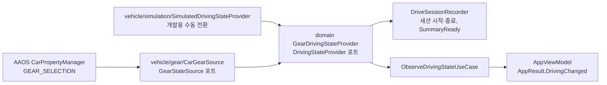

# T-034 차량 기어 상태로 주행 중과 주행 완료 판정

## 목표

개발용 수동 전환(`SimulatedDrivingStateProvider`)만으로 정하던 주행 상태(`DrivingState`)를 차량 기어로 정한다. 기어 P는 주행 완료(주차), 그 밖의 기어는 주행 중이다. 이 상태가 화면 전환(S-005, `AppViewModel.showDriving`)과 주행 세션 기록·요약(F-009, S-009, SCR-008)을 그대로 움직인다. 기어는 AAOS `CarPropertyManager`의 `GEAR_SELECTION`으로 읽는다(결정 로그).

## 범위 밖

- `CarUxRestrictions` 연동(DI-001, DI-002)은 T-035에서 했다. 이 작업의 `DrivingState`는 주행 세션과 화면 전환 기준이다.
- 미지원 안내 UI. 기어를 읽지 못하면 앱은 주차 상태로 남고, 개발 빌드에서는 수동 전환을 쓴다.
- 기어 외 신호(속도, 주차 브레이크)로 주행을 보정하는 것

## 조사 결과

[sdk-usage-map.md](../../platform/sdk-usage-map.md#기어-상태t-034)에 정리했다. 요점:

- 처음 쓴 Pleos Vehicle SDK 2.3.2 `Vehicle.getGear()`는 공식 문서(v2.3.1)에 없고, AAR의 `Gear` 세 함수가 모두 `@Deprecated("... use the Google GEAR_SELECTION property.")`다.
- AAOS `VehiclePropertyIds.GEAR_SELECTION`: 읽기 전용, ON_CHANGE, Integer, normal 권한 `Car.PERMISSION_POWERTRAIN`. 값은 `VehicleGear`(P=4, R=2, N=1, D=8, 1~9단=16~4096, UNKNOWN=0). `configArray`가 지원 기어 목록이다.
- Pleos 정책 API-002도 기어 같은 표준 데이터는 AAOS Car API를 쓰라고 한다.

## 설계

- domain
  - `GearPosition`(PARK, REVERSE, NEUTRAL, DRIVE, MANUAL, UNKNOWN), `GearReading`(`Selected`, `Unavailable`)
  - 포트 `GearStateSource.gear: Flow<GearReading>`. 수집하는 동안 차량 서비스에 연결한다.
  - `GearDrivingStateProvider(gearSource, fallback, scope)`가 기존 `DrivingStateProvider` 포트를 구현한다. 판정 규칙은 `resolveDrivingState`다.
    - P → PARKED, R·N·D·수동 단수 → DRIVING, UNKNOWN → 상태 유지
    - 기어를 한 번도 읽지 못했으면 대체 흐름(개발용 수동 전환)을 따른다. 출시 빌드는 수동 전환 버튼이 없어 주차로 남는다.
    - 기어를 읽은 뒤 오류가 오면 마지막 상태를 유지한다. 일시 오류로 세션이 닫히고 요약이 뜨지 않게 한다.
    - 개발용 수동 전환은 기어를 읽은 뒤에도 다음 기어 변경 전까지 우선한다(개발 빌드 버튼 유지).
    - `stateIn(WhileSubscribed)`로 공유해 주행 기록과 화면이 연결 하나를 쓴다.
- vehicle: `vehicle/gear/CarGearSource`
  - 차량 환경(`FEATURE_AUTOMOTIVE`)인지 확인하고(HW-003), `Car.createCar(..., CAR_WAIT_TIMEOUT_DO_NOT_WAIT, listener)`로 연결한다. 준비될 때마다 콜백을 다시 등록한다.
  - `getCarPropertyConfig(GEAR_SELECTION)`가 없거나 지원 기어에 P가 없으면 `Unavailable`(CP-005). 차량 모델명으로 분기하지 않는다(CP-006).
  - `registerCallback(..., SENSOR_RATE_ONCHANGE)`. 등록하면 현재 값이 첫 이벤트로 온다. `STATUS_AVAILABLE`이 아니면 UNKNOWN, 오류 이벤트는 `Unavailable`
- MVI: 변경 없음. `AppViewModel`은 `ObserveDrivingStateUseCase` → `AppResult.DrivingChanged`로 받고, 주차 후 요약은 `DriveSessionRecorder` → `ObserveUnseenDriveSummaryUseCase` → `AppResult.SummaryReady` → SCR-008로 이어진다.
- 의존성과 권한: `useLibrary("android.car")`(T-035와 공유), 매니페스트 `android.car.permission.CAR_POWERTRAIN`. Pleos Vehicle SDK 의존성은 다시 비활성으로 돌렸다.

## 작업 체크리스트

- [x] T-034 등록(main이 T-032, T-033을 먼저 써서 이 번호로 다시 받음)
- [x] 기어 API 조사와 sdk-usage-map 기록
- [x] domain 모델·포트·`GearDrivingStateProvider`와 단위 테스트
- [x] 기어 어댑터, 권한, AppContainer 연결
- [x] Pleos `Gear`(deprecated)에서 AAOS `GEAR_SELECTION`(`CarGearSource`)으로 교체
- [x] F-009, S-005, S-009, SCR-008, ARCHITECTURE, driving-restriction-impl 갱신
- [x] L1 검증(`./harness/verify.sh`, `:core:domain:test`, `--docs`)
- [x] 에뮬레이터에서 기어 미지원 대체 흐름 확인(서비스 없음 → 주차 유지, 비정상 종료 없음)
- [ ] 개발 버튼으로 수동 전환 확인. 일반 AAOS 이미지에서는 버튼이 상태 표시줄 아래에 있어 누를 수 없었다(기존 화면 배치 문제)
- [x] Pleos 이미지 에뮬레이터에서 P ↔ D 전환으로 주행 상태, 화면 전환, 요약 확인
- [ ] 실차·데브박스에서 기어 수신 확인

## 검증 방법

- L1: `./gradlew :core:domain:test`(판정 규칙), `:app` 단위 테스트(`GearPositionMappingTest`), `./harness/verify.sh`, `./harness/verify.sh --docs`
- 에뮬레이터: Pleos 이미지 AVD에서 Virtual Console(`adb forward tcp:8088 tcp:8088`)로 기어를 D로 바꾸면 주행 화면(SCR-004)으로, P로 바꾸면 바로 주행 요약(SCR-008)이 뜨는지 본다.

## 미결

- 수동 변속기처럼 지원 기어에 P가 없는 차량의 주행 완료 기준. 지금은 기어로 판정하지 않고 대체 흐름을 따른다
- 차량 서비스 재연결 때 이벤트 순서
- 재설치 직후 첫 기어 변경 이벤트를 놓친 사례 1회(에뮬레이터). 재현되면 원인을 찾는다
- N(세차, 견인)이나 주차장 안 R 조작도 주행으로 본다. 주행 세션이 짧게 생길 수 있다. 기록 없는 세션은 요약을 만들지 않는다(F-009 예외).

## 결정 로그

- 2026-11-14: 주행 요약을 기어 P 3분 뒤가 아니라 P 즉시 띄운다(사용자 결정). `DriveSessionRecorder.endDelay` 기본값을 0으로 바꿨다. 잠깐 P에 두었다 출발하면 세션과 요약이 나뉜다.
- 2026-11-14: 사용자 요청에 따라 처음에는 Pleos Vehicle SDK의 기어 상태를 썼다.
- 2026-11-14: 리베이스 뒤 빌드 경고로 Pleos `Gear` API가 deprecated("use the Google GEAR_SELECTION property")임을 확인했다. 사용자 결정으로 AAOS `GEAR_SELECTION`(`CarGearSource`)으로 바꾸고 Vehicle SDK 의존성과 `CAR_DRIVE` 권한을 뺐다. API-002와도 맞는다. 지원 기어에 P가 없는 차량(수동 변속기)은 기어로 판정하지 않는다.
- 2026-11-14: 기어 P = 주행 완료, 그 밖의 기어 = 주행 중(사용자 결정). `GEAR_UNKNOWN`은 기어가 아니므로 상태를 바꾸지 않는다(팀 해석).
- 2026-11-14: 기어를 읽은 뒤 오류는 상태 유지, 처음부터 못 읽으면 개발용 수동 전환을 대체 흐름으로 쓴다.
- 2026-11-14: 머지 전인 지역 순위 작업 브랜치가 `DriveSummaryUseCases.kt`, `Ports.kt`, F-009를 바꾸고 있어 새 포트와 판정 규칙은 새 파일에 두고 F-009는 규칙 1만 고친다.

## 진행 기록

- 2026-11-14: 조사, 설계, 구현, 단위 테스트(`GearDrivingStateProviderTest` 9건, `VehicleGearMappingTest` 2건)
- 2026-11-14: `./harness/verify.sh`, `:core:domain:test`, `--docs` 통과. 로컬 AVD `Pleos_Connect_v2.1.0`(빌드 지문 `sdk_gcar_arm64`, Android 15)에는 Pleos Vehicle 서비스(`VEHICLE_START` 처리 서비스)와 Virtual Console(8088)이 없었다. `CAR_DRIVE` 권한 정의가 없어 `registerGearSelection`이 `SecurityException`을 던졌고, `PleosGear` 경고 로그 후 홈(주차)으로 남았다. 실제 기어 P ↔ D 전환, `onSelected` 수신, 주차 3분 뒤 요약 표시는 Vehicle 서비스가 있는 환경에서 확인해야 한다
- 2026-11-14: 로컬 AVD `Pleos_Connect_v2.1.0`의 시스템 이미지가 Pleos 이미지가 아니라 일반 Android 15 Automotive(`android-35-ext15/android-automotive`)였다. 설치된 Pleos 이미지(`android-34/pleos_car_emulator`)로 검증용 AVD `Pleos_Connect_T032_test`(Cold boot, RAM 4GB, 데이터 4GB)를 따로 만들었다. 빌드 지문 `Pleos/crp_avd_arm64/...:14/RELEASE.release_connect_v2.1.0`, Vehicle 서비스(`ai.pleos.playground.service.vehicle`), `CAR_DRIVE` 권한 정의, Virtual Console(8088)이 있었다
- 2026-11-14: Pleos 이미지에서 확인한 SDK 동작. `CAR_DRIVE`는 설치 시 허용됐다. `initialize()` 직후 `registerGearSelection`을 불러도 SDK가 요청을 쌓아 두고, 서비스 연결(약 1초) 뒤 `VENDOR_GEAR_SELECTION` 현재 값을 보냈다. 콜백은 binder 스레드에서 왔다. 값은 P=4, D=8로 `VehicleGear` id와 같다
- 2026-11-14: Virtual Console에서 P → D → P → D → P를 바꾸자 앱이 매번 값을 받았다. D에서 앱 UI 트리는 주행 화면(`순위`, `지도`, `주행 중`, 개발 버튼 `주차`)으로 바뀌었지만 화면에는 플랫폼의 `주행 중에는 사용할 수 없습니다`가 덮였다. P로 돌아오면 홈(개발 버튼 `주행 시작`)으로 돌아왔다. 에뮬레이터에서 실거래 갱신이 실패해(`갱신하지 못했어요`) 순위 스냅샷과 주행 세션이 생기지 않아 요약은 확인하지 못했다
- 2026-11-14: 에뮬레이터 GPS를 삼성전자 수원 본사 부근으로 옮긴 뒤(location-input.md) Virtual Console로 D → P를 고르고 3분 기다리자 주행 요약(SCR-008) `오늘의 임장 요약`이 자동으로 떴다. 최종 순위 Top 3와 `대장 교체 없음`이 보였다([화면](../../screenshots/T-034-summary-after-park.png))
- 2026-11-14: 요약 대기 시간을 0으로 바꾼 뒤 같은 에뮬레이터에서 D(약 20초) → P를 고르자 3초 안에 `오늘의 임장 요약`이 떴다([화면](../../screenshots/T-034-summary-after-park.png))
- 2026-11-14: AAOS `GEAR_SELECTION`으로 바꾼 뒤 Pleos 이미지 AVD에서 확인했다. `CAR_POWERTRAIN`은 설치 시 허용됐고, 연결하면 현재 값 4(P)가 첫 이벤트로 왔다. Virtual Console로 P → D → P → D → P를 고르자 8, 4, 8, 4가 1초 안에 왔고, D에서 주행 화면, P에서 주행 요약이 바로 떴다. 재설치 직후 처음 고른 D 한 번은 앱에 이벤트가 오지 않았다. 원인은 확인하지 못했다(미결)

